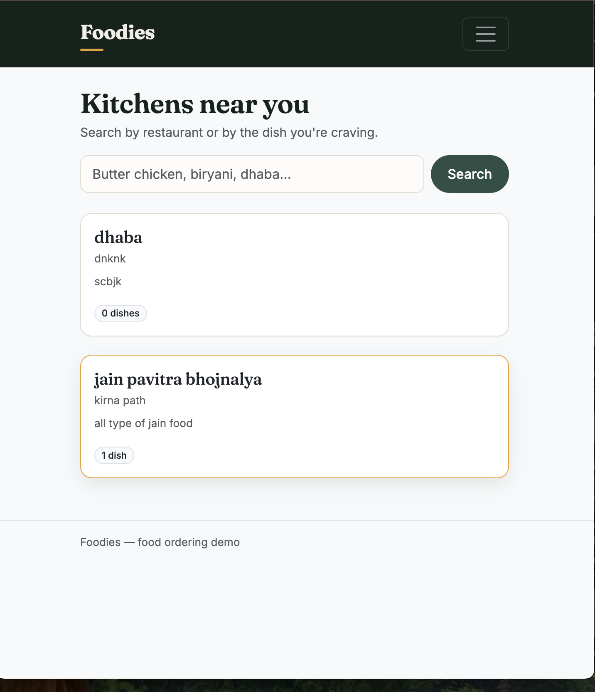
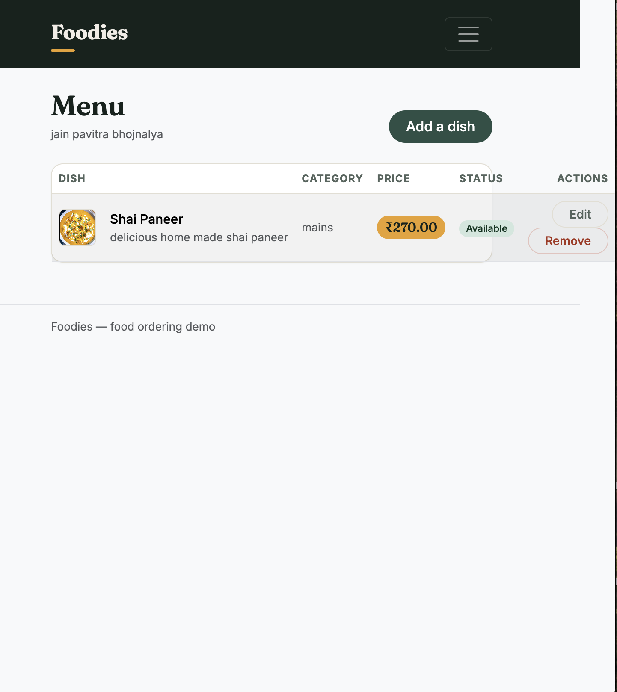
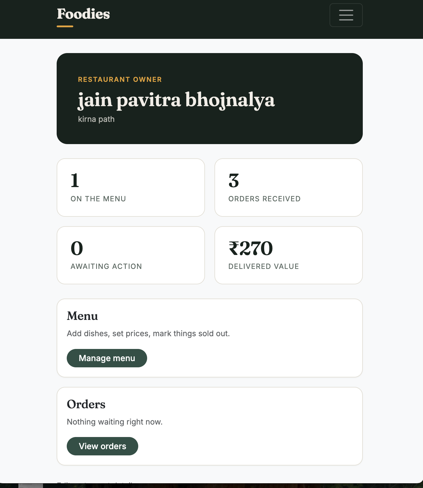

# Foodies

A food ordering web application built with PHP and MySQL. Restaurant owners manage a menu and fulfil orders; customers browse, search, build a cart, and check out.



## Features

**Customers** — browse restaurants, search across both restaurant and dish names, add items to a bucket, adjust quantities, check out, and track order status.

**Owners** — create a restaurant, manage the menu with photo uploads and availability toggles, view incoming orders, and move them through the fulfilment stages.




## Stack

PHP 8.5 · MySQL 9 · PDO · Bootstrap 5

No framework — routing is the filesystem, templating is PHP.

## Running it locally

Requires PHP 8.1+ and MySQL 8+.

```bash
git clone https://github.com/nikhil4u8/foodies.git
cd foodies

mysql -u root -p -e "CREATE DATABASE foodies CHARACTER SET utf8mb4 COLLATE utf8mb4_unicode_ci;"
mysql -u root -p foodies < database/schema.sql
mysql -u root -p foodies < database/seed.sql

cp config/db_credentials.example.php config/db_credentials.php
# edit that file with your MySQL username and password

php -S localhost:8000
```

Open http://localhost:8000.

Seeded accounts, password `password123`:

| Email | Role |
|---|---|
| `owner@foodies.test` | Restaurant owner |
| `customer@foodies.test` | Customer |

## Schema

Six tables. `users` holds both roles, distinguished by a `role` column rather than split across two tables, so authentication has one path.

`restaurants` and `menu_items` cascade on delete. `orders` deliberately does not — deleting a customer shouldn't erase financial history, so MySQL blocks it and forces the case to be handled explicitly.

`order_items` stores `item_name` and `unit_price` copied from the menu at purchase time rather than referencing it. Order history has to survive a price change: if a dish goes from ₹200 to ₹250, past orders must still read ₹200.

## Security

- Prepared statements throughout with `PDO::ATTR_EMULATE_PREPARES` disabled, so parameters are sent separately from the query and never parsed as SQL
- Passwords hashed with bcrypt via `password_hash()`
- Session ID regenerated on login to prevent fixation
- Every write scoped by ownership (`WHERE id = ? AND owner_id = ?`) — an ID in a URL doesn't grant access to another user's row
- Uploads stored under a random filename with the extension derived from the sniffed MIME type, never from the submitted name
- All user-supplied output escaped through a helper
- Checkout wraps its three writes in a transaction

## Limitations

No payment integration or delivery tracking. One restaurant per owner, and one restaurant per checkout.